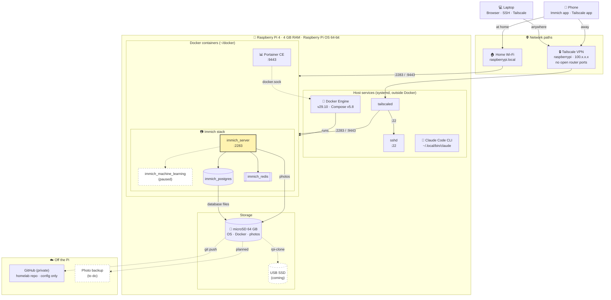
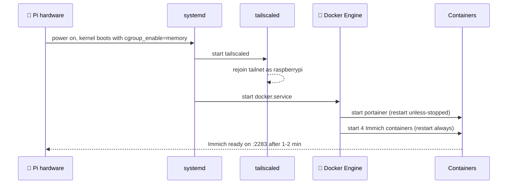
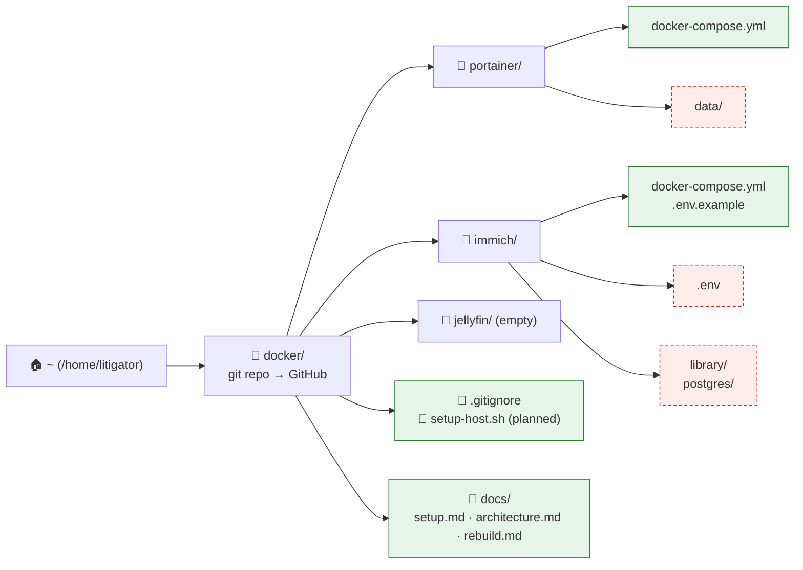

# Architecture — Pi Homelab

**Last updated:** 2026-11-22 · **Host:** `raspberrypi` · **Repo:** `Litigator98765/homelab` (private)

How the homelab is put together. For what was done and the commands used, see
[`setup.md`](setup.md). To rebuild from scratch, see [`rebuild.md`](rebuild.md).

---

## 1. Overall architecture

A single Raspberry Pi 4 runs two kinds of software:

- **Host services** (managed by systemd, outside Docker): `sshd`, `tailscaled`, the
  Docker Engine, and the Claude Code CLI.
- **Docker containers** (defined in `~/docker/*/docker-compose.yml`): Portainer and
  the four-container Immich stack.

Devices reach the Pi two ways: **home Wi-Fi** (`raspberrypi.local`) when at home, and
**Tailscale** (`raspberrypi` / `100.x.x.x`) from anywhere. No ports are opened on the
router, so nothing is exposed to the public internet.

**Legend:** yellow = main app · dashed box = planned or paused · dashed arrow = occasional or planned flow

---

## 2. What each component does

| Component | Type | Role | Address | Restart policy |
|---|---|---|---|---|
| `immich_server` | Docker | Web UI, API, uploads, thumbnails, video transcoding, job workers | `:2283` | `always` |
| `immich_machine_learning` | Docker | Face recognition + smart search (CLIP). **Paused** to save RAM | internal | `always` |
| `immich_postgres` | Docker | Photo index: assets, albums, people, search vectors | internal | `always` |
| `immich_redis` | Docker | Background job queue (Valkey) | internal | `always` |
| Portainer CE 2.45 | Docker | Dashboard for containers: status, stats, logs, console | `:9443` (HTTPS) | `unless-stopped` |
| Docker Engine | Host | Runs all containers | — | systemd, on boot |
| tailscaled | Host | Private encrypted network to phone + laptop | `raspberrypi` / `100.x.x.x` | systemd, on boot |
| sshd | Host | Remote terminal | `:22` | systemd, on boot |
| Claude Code | Host CLI | AI assistant in the terminal | `claude` | n/a |

---

## 3. Sequence — phone photo backup

What happens when the Immich app uploads a photo (shown via Tailscale; at home the
Wi-Fi path replaces the Tailscale hop).

---

## 4. Sequence — what happens at boot

Everything comes back on its own after a reboot or power loss.

---

## 5. Folder layout and what git tracks

Green = committed to GitHub · red dashed = ignored (secrets or data).

Data that lives **outside** `~/docker` and is not in git: `/var/lib/docker` (images,
volumes), `/var/lib/tailscale` (login keys — secret), `/boot/firmware/cmdline.txt`
(+ `.bak`).

---

## 6. Key design decisions

- **Docker Compose files in `~/docker`, not Portainer stacks** — config stays in plain
  files that git can track and that move with the SSD; Portainer only monitors.
- **Tailscale on the host, not in a container** — remote access (including SSH) keeps
  working even if Docker breaks.
- **No public exposure** — no router port-forwarding; all remote access is over
  Tailscale.
- **Immich ML paused on the SD card** — the Pi has 4 GB of RAM (soldered, not
  upgradeable). Re-enable after moving to the SSD and run Jobs → Missing.
- **Immich storage template `{{y}}/{{y}}-{{MM}}/{{filename}}`** — photos on disk stay
  human-readable, so there is no lock-in if Immich is ever replaced.
- **Secrets never in git** — `.env`, `portainer/data/`, and Tailscale keys are ignored;
  `.env.example` documents the settings with a placeholder password.

---

## 7. Planned changes

| Change | Effect on this diagram |
|---|---|
| Clone SD → USB SSD and boot from it | `SD` replaced by `SSD` as the storage node |
| Re-enable Immich ML | `ML` no longer dashed |
| Photo backup (2nd drive / Backblaze B2) | `BK` becomes solid with a scheduled arrow |
| Jellyfin + powered external HDD | New container under Docker; HDD node under Storage |
