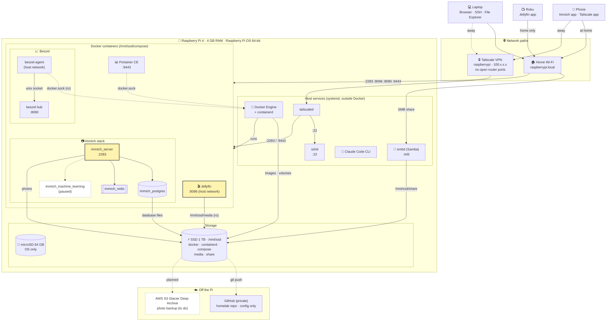
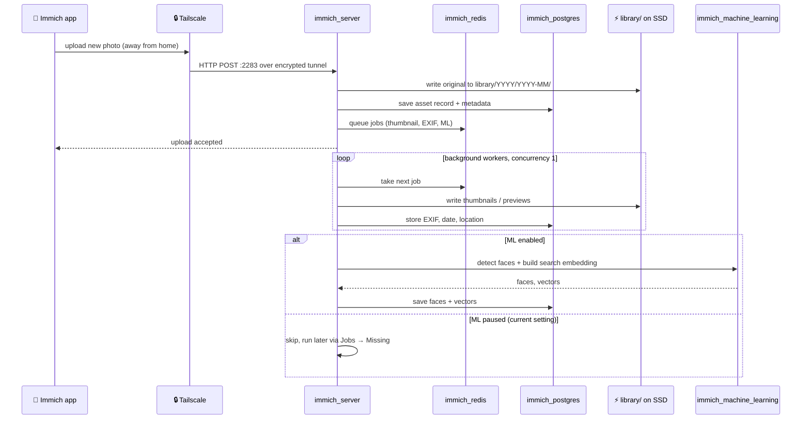
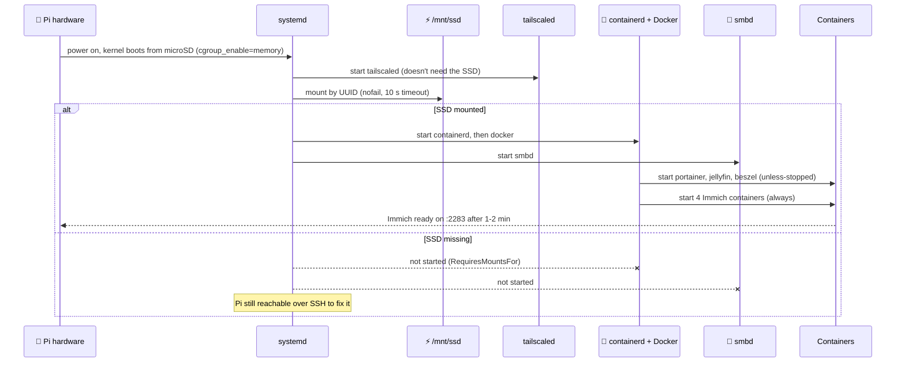
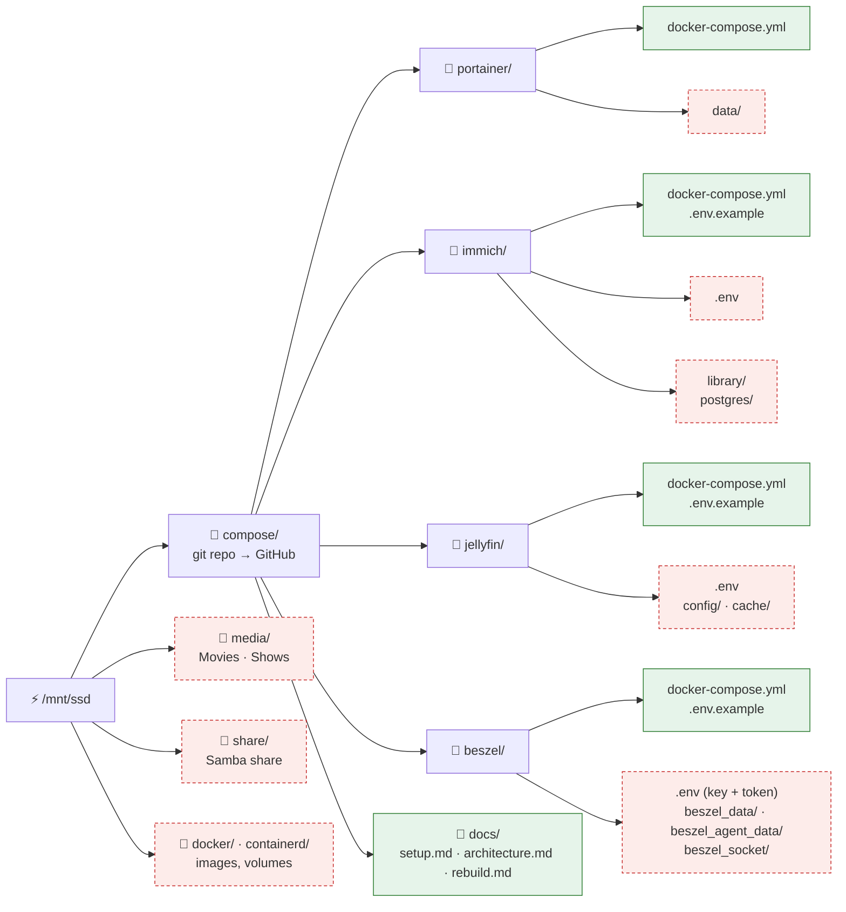

# Architecture — Pi Homelab

**Last updated:** 2026-11-24 · **Host:** `raspberrypi` · **Repo:** `Litigator98765/homelab` (private)

How the homelab is put together. For what was done and the commands used, see
[`setup.md`](setup.md). To rebuild from scratch, see [`rebuild.md`](rebuild.md).

---

## 1. Overall architecture

A single Raspberry Pi 4 runs two kinds of software:

- **Host services** (managed by systemd, outside Docker): `sshd`, `tailscaled`, `smbd`
  (Samba file share), the Docker Engine + containerd, and the Claude Code CLI.
- **Docker containers** (defined in `/mnt/ssd/compose/*/docker-compose.yml`): Portainer,
  Jellyfin, Beszel (hub + agent) and the four-container Immich stack.

Storage is split across two drives:

- **microSD (64 GB):** the OS only. The Pi always boots, even without the SSD.
- **SanDisk USB SSD (1 TB) at `/mnt/ssd`:** Docker and containerd data, the compose
  projects (this repo), media and the Samba share.

Devices reach the Pi two ways: **home Wi-Fi** (`raspberrypi.local`) when at home, and
**Tailscale** (`raspberrypi` / `100.x.x.x`) from anywhere. No ports are opened on the
router, so nothing is exposed to the public internet.

**Legend:** yellow = main apps · dashed box = planned or paused · dashed arrow = occasional or planned flow

---

## 2. What each component does

| Component | Type | Role | Address | Restart policy |
|---|---|---|---|---|
| `immich_server` | Docker | Web UI, API, uploads, thumbnails, video transcoding, job workers | `:2283` | `always` |
| `immich_machine_learning` | Docker | Face recognition + smart search (CLIP). **Paused** to save RAM | internal | `always` |
| `immich_postgres` | Docker | Photo index: assets, albums, people, search vectors | internal | `always` |
| `immich_redis` | Docker | Background job queue (Valkey) | internal | `always` |
| `jellyfin` | Docker | Media server for movies and shows (Roku, browser). Host network so Roku discovery works | `:8096` | `unless-stopped` |
| `beszel` | Docker | Monitoring dashboard: history for CPU, RAM, temp, disks, network, per-container stats | `:8090` | `unless-stopped` |
| `beszel-agent` | Docker | Collects stats for the hub; talks to it over a unix socket | none (socket) | `unless-stopped` |
| Portainer CE 2.45 | Docker | Dashboard for containers: status, stats, logs, console | `:9443` (HTTPS) | `unless-stopped` |
| Docker Engine + containerd | Host | Run all containers. Data on the SSD; wait for `/mnt/ssd` to mount | — | systemd, on boot |
| smbd (Samba) | Host | Windows file share of `/mnt/ssd/share`. Waits for `/mnt/ssd` | `:445` | systemd, on boot |
| tailscaled | Host | Private encrypted network to phone + laptop | `raspberrypi` / `100.x.x.x` | systemd, on boot |
| sshd | Host | Remote terminal | `:22` | systemd, on boot |
| Claude Code | Host CLI | AI assistant in the terminal | `claude` | n/a |

---

## 3. Sequence — phone photo backup

What happens when the Immich app uploads a photo (shown via Tailscale; at home the
Wi-Fi path replaces the Tailscale hop).

---

## 4. Sequence — what happens at boot

Everything comes back on its own after a reboot or power loss. Anything whose data is on the
SSD waits for it to mount (`RequiresMountsFor=/mnt/ssd`). If the SSD is missing, the Pi still
boots (`nofail`), SSH and Tailscale work, and Docker + Samba stay stopped instead of writing
to the SD card.

---

## 5. Folder layout and what git tracks

Green = committed to GitHub · red dashed = ignored (secrets or data).

Not in git and not on the SSD: `/etc/fstab`, `/etc/docker/daemon.json`,
`/etc/containerd/config.toml`, the `RequiresMountsFor` drop-ins in
`/etc/systemd/system/*.service.d/`, `/etc/samba/smb.conf`, `/var/lib/tailscale` (login keys —
secret) and `/boot/firmware/cmdline.txt`. These are all on the SD card; `rebuild.md` has the
commands to recreate them.

---

## 6. Key design decisions

- **OS on the SD card, everything else on the SSD** — the Pi always boots and stays reachable
  over SSH even if the SSD is unplugged or dies. `nofail` + `RequiresMountsFor` stop Docker and
  Samba from silently writing to the SD card when the SSD is missing, and the empty mount
  point is made immutable (`chattr +i`) as a second guard.
- **Both Docker and containerd moved** — Docker 29 stores images in containerd, so moving
  only Docker's `data-root` would leave images on the SD card.
- **Docker Compose files in a git repo, not Portainer stacks** — config stays in plain files
  that git can track and that move as one folder; Portainer only monitors.
- **Tailscale and Samba on the host, not in containers** — remote access, SSH and the file
  share keep working even if Docker breaks; Samba writes files as the real `litigator` user.
- **Beszel for monitoring** — light enough to run next to Immich + Jellyfin on 4 GB, keeps
  history, and the hub ↔ agent link is a unix socket, so the agent opens no network port.
- **No public exposure** — no router port-forwarding; all remote access is over Tailscale.
  Jellyfin is home-only (Roku).
- **Jellyfin on the host network** — Roku finds servers with a UDP broadcast that Docker's
  bridge network doesn't forward.
- **Immich ML paused** — the Pi has 4 GB of RAM (soldered, not upgradeable). Re-enable and run
  Jobs → Missing now that data is on the SSD.
- **Immich storage template `{{y}}/{{y}}-{{MM}}/{{filename}}`** — photos on disk stay
  human-readable, so there is no lock-in if Immich is ever replaced.
- **Secrets never in git** — `.env` files (Immich DB password, Beszel key + token),
  `portainer/data/` and Tailscale keys are ignored; `.env.example` files document the settings.

---

## 7. Planned changes

| Change | Effect on this diagram |
|---|---|
| Re-enable Immich ML | `ML` no longer dashed |
| Photo backup to AWS S3 Glacier Deep Archive | `BK` becomes solid with a scheduled arrow |
| Samba `[media]` share | Second arrow from `smbd` to `/mnt/ssd/media` |
| Tailscale on the laptop | Laptop's dashed Tailscale arrow becomes solid |
